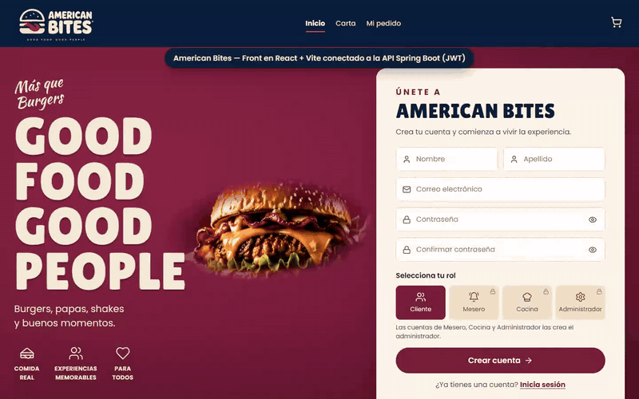

# 🍔 American Bites — Front

Frontend del restaurante **American Bites**, hecho en **React + Vite**. Consume la API REST del back
([Bitacora_Corte2_JuanValderrama](https://github.com/juandivg26/Bitacora_Corte2_JuanValderrama)): Spring Boot, JWT, PostgreSQL y MongoDB.

**Autor:** Juan Diego Valderrama Gaviria

---

## 🎬 Video de funcionalidades

[](docs/demo-american-bites.mp4)

▶️ **[Ver el video completo (2:23)](docs/demo-american-bites.mp4)**

El video recorre la plataforma con cada rol:

| # | Qué se ve |
|---|---|
| 1 | Menú público, filtro por categorías |
| 2 | Login fallido (401) y login como **ADMINISTRADOR** (JWT) |
| 3 | Gestión de platos: crear, nombre duplicado (409), activar y desactivar |
| 4 | Mesas: crear y cambiar estado. Lista de usuarios |
| 5 | **MESERO**: toma un pedido con varios platos y abre la cuenta de la mesa |
| 6 | **COCINERO**: pedido RECIBIDO → EN_PREPARACION → LISTO → ENTREGADO, y el log de eventos en MongoDB |
| 7 | **CAJERO**: registra el pago y cierra la cuenta |
| 8 | **CLIENTE** nuevo: se registra, hace una reserva y la cancela |

---

## Funcionalidades por rol

Las pestañas que ve cada usuario dependen de su rol (es la misma matriz de permisos del `SecurityConfig` del back).
Si alguien intenta algo sin permiso, el back responde 401 o 403 y el front muestra el mensaje.

| Sección | Endpoint del back | ADMIN | MESERO | COCINERO | CAJERO | CLIENTE | Sin login |
|---|---|:-:|:-:|:-:|:-:|:-:|:-:|
| Menú | `GET /menu` | ✅ | ✅ | ✅ | ✅ | ✅ | ✅ |
| Platos (CRUD, disponibilidad) | `/platos` | ✅ | | | | | |
| Mesas (ver) / crear, eliminar / cambiar estado | `/mesas` | ✅ | ver, estado | ver | ver | | |
| Pedidos (crear) / cambiar estado | `/pedidos` | ✅ | ✅ | estado | ver | | |
| Cuentas (abrir) / pago y cierre | `/cuentas` | ✅ | abrir | | pago y cierre | | |
| Reservas (crear, cancelar, listar) | `/reservas` | ✅ | ✅ | | listar | crear y cancelar | |
| Eventos de pedidos (MongoDB) | `GET /eventos` | ✅ | ✅ | ✅ | ✅ | | |
| Usuarios | `GET /usuarios` | ✅ | | | | | |
| Login y registro | `/auth/login`, `/auth/registro` | | | | | | ✅ |

## Cómo funciona la autenticación

1. `POST /auth/login` devuelve `{ token, email, rol }`.
2. El front guarda la sesión en `localStorage` y manda `Authorization: Bearer <token>` en cada petición ([src/api.js](src/api.js)).
3. Si el back responde **401** (token vencido o inválido), el front cierra la sesión.

## Cómo ejecutarlo

**1. Levantar el back** (en el repo del back):

```bash
docker compose up --build -d
```

**2. Levantar el front:**

```bash
npm install
npm run dev
```

Abrir http://localhost:5173. El back ya permite este origen en su `CorsConfig`.

Para apuntar a otro back (por ejemplo, QA en Azure), crea un archivo `.env` basado en `.env.example`:

```
VITE_API_URL=https://<tu-app>.azurewebsites.net/api/v1
```

### Usuarios de prueba (los crea el back al iniciar)

| Rol | Email | Contraseña |
|---|---|---|
| ADMINISTRADOR | admin@americanbites.com | Admin123* |
| MESERO | mesero@americanbites.com | Mesero123* |
| COCINERO | cocinero@americanbites.com | Cocinero123* |
| CAJERO | cajero@americanbites.com | Cajero123* |
| CLIENTE | cliente@americanbites.com | Cliente123* |

## Estructura

```
src/
├── main.jsx     ← punto de entrada
├── api.js       ← fetch al back con el token JWT y manejo de errores
├── App.jsx      ← sesión, menú por rol y las secciones (Menú, Platos, Mesas, Pedidos, Cuentas, Reservas, Eventos, Usuarios)
└── styles.css   ← estilos
docs/            ← video de la demo
```

## Tecnologías

React 18 · Vite 6 · Fetch API · sin librerías extra.
