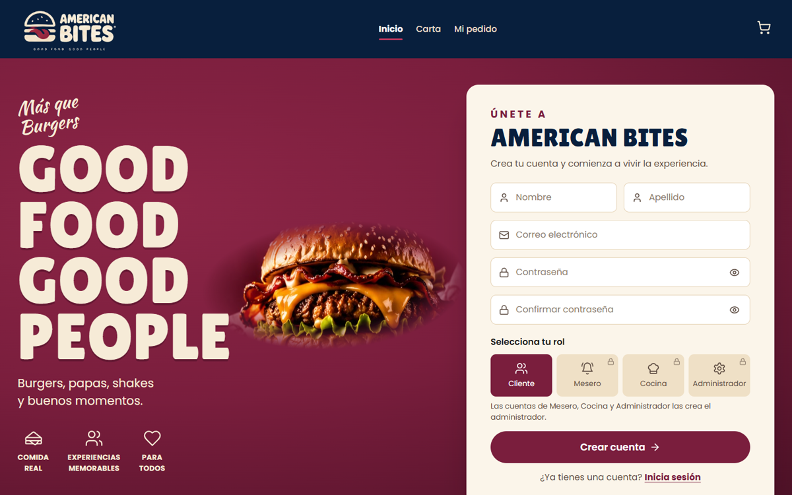
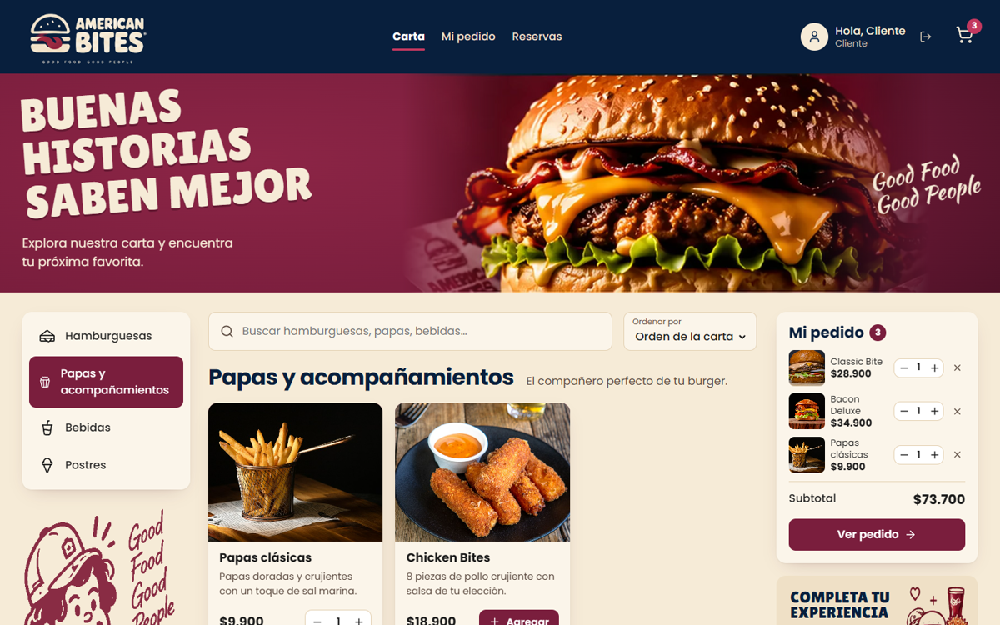
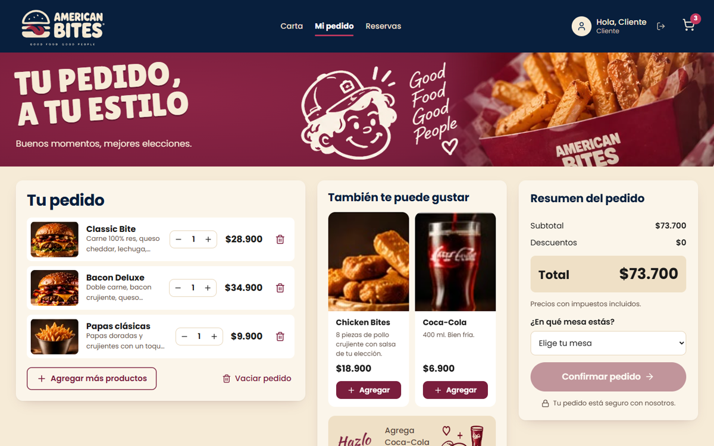
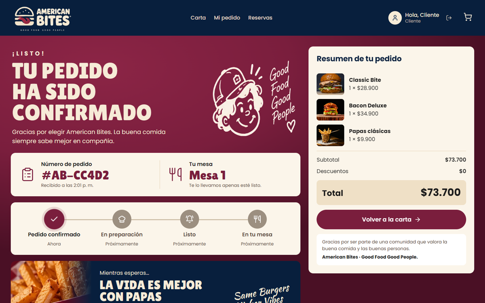
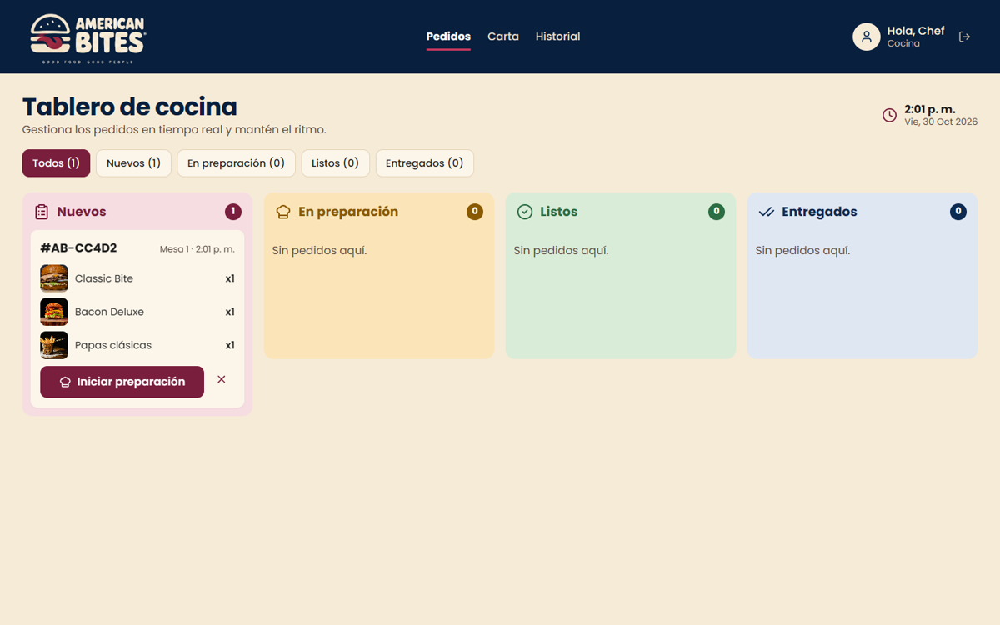
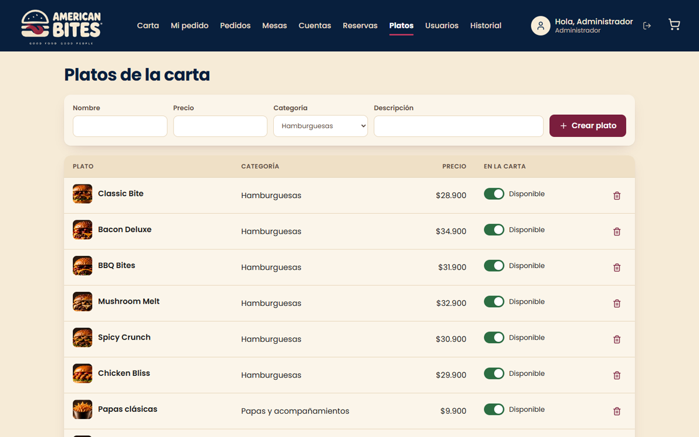

# 🍔 American Bites — Front

Frontend del restaurante **American Bites** (*Good Food Good People*), hecho en **React + Vite**.
Consume la API REST del back [Bitacora_Corte2_JuanValderrama](https://github.com/juandivg26/Bitacora_Corte2_JuanValderrama) (Spring Boot, JWT, PostgreSQL y MongoDB).

**Autor:** Juan Diego Valderrama Gaviria
**Asignatura:** DOSW, Escuela Colombiana de Ingeniería Julio Garavito. Corte 2

---

## 🎬 Video de funcionalidades

[](docs/demo-american-bites.mp4)

▶️ **[Ver el video completo (2:25)](docs/demo-american-bites.mp4)**

| # | Qué se ve en el video |
|---|---|
| 1 | **Registro** de un cliente nuevo (los roles de personal están bloqueados: los asigna el administrador) |
| 2 | **Carta**: categorías, búsqueda y "Mi pedido" al lado con cantidades |
| 3 | **Mi pedido**: sugerencias, "Hazlo combo", elegir mesa y confirmar (`POST /pedidos`) |
| 4 | **Confirmación** con número de pedido y **seguimiento en vivo**: la cocina cambia el estado y el cliente lo ve sin recargar |
| 5 | **Reserva** de mesa del cliente |
| 6 | **Cocina**: tablero por columnas (Nuevos, En preparación, Listos, Entregados) y el **historial en MongoDB** |
| 7 | **Mesero**: toma el pedido de otra mesa, ve las mesas ocupadas y abre la cuenta |
| 8 | **Caja**: registra el pago y cierra la cuenta |
| 9 | **Administrador**: crea un plato, lo oculta y lo vuelve a mostrar en la carta, y ve los usuarios |

## 📸 Pantallas

| Registro | Carta |
|---|---|
|  |  |
| **Mi pedido** | **Confirmación y seguimiento** |
|  |  |
| **Tablero de cocina** | **Gestión de platos (admin)** |
|  |  |

---

## Funcionalidades por rol

Cada rol ve solo sus pestañas. Es la misma matriz de permisos del `SecurityConfig` del back, y el back la vuelve a validar con el JWT: si alguien intenta algo sin permiso, recibe 401 o 403 y el front muestra el mensaje.

| Pantalla | Endpoints | Cliente | Mesero | Cocina | Caja | Admin | Sin sesión |
|---|---|:-:|:-:|:-:|:-:|:-:|:-:|
| Inicio (registro e inicio de sesión) | `/auth/registro`, `/auth/login`, `/auth/me` | | | | | | ✅ |
| Carta | `GET /menu` | ✅ | ✅ | solo ver | | ✅ | solo ver |
| Mi pedido (elige mesa y confirma) | `GET /mesas/disponibles`, `POST /pedidos` | ✅ | ✅ | | | ✅ | pide iniciar sesión |
| Seguimiento del pedido | `GET /pedidos/{id}` (cada 4 s) | ✅ | ✅ | | | ✅ | |
| Tablero de pedidos | `GET /pedidos` (cada 5 s), `PATCH /pedidos/{id}/estado` | | ✅ | ✅ | solo ver | ✅ | |
| Mesas | `GET/POST/DELETE /mesas`, `PATCH /mesas/{id}/estado` | | estado | | ver | ✅ | |
| Cuentas | `GET/POST /cuentas`, `PATCH /cuentas/{id}/pago`, `/cerrar` | | abrir | | pago y cierre | ✅ | |
| Reservas | `GET/POST /reservas`, `PATCH /reservas/{id}/cancelar` | crear y cancelar | ✅ | | ver | ✅ | |
| Platos | `/platos` (CRUD y disponibilidad) | | | | | ✅ | |
| Usuarios | `GET /usuarios` | | | | | ✅ | |
| Historial (MongoDB) | `GET /eventos` | | | ✅ | ✅ | ✅ | |

> Para que el cliente pudiera pedir desde su mesa, como en el diseño, el back ahora permite al rol **CLIENTE** usar `GET /mesas/disponibles`, `POST /pedidos` y `GET /pedidos/{id}`. El cliente sigue sin poder listar todos los pedidos ni cambiar estados. Hay tests de seguridad para estos casos.

## Cómo funciona la sesión

1. `POST /auth/login` devuelve `{ token, email, rol }`. Luego `GET /auth/me` trae el nombre para el saludo "Hola, Mateo".
2. La sesión se guarda en `localStorage` y cada petición manda `Authorization: Bearer <token>` ([src/api.js](src/api.js)).
3. Si el back responde **401** (token vencido o inválido), el front cierra la sesión.
4. La pantalla actual va en la URL (`#carta`, `#pedido`, `#cocina`…), así que el botón atrás y recargar funcionan.

## Cómo ejecutarlo

**1. Levantar el back** (en el repo del back):

```bash
docker compose up --build -d
```

**2. Levantar el front:**

```bash
npm install
npm run dev
```

Abrir http://localhost:5173. El back ya permite este origen en su `CorsConfig`.

Para apuntar a otro back (por ejemplo, QA en Azure), crea un archivo `.env` basado en `.env.example`:

```
VITE_API_URL=https://<tu-app>.azurewebsites.net/api/v1
```

### Usuarios de prueba (los crea el back al iniciar)

En modo desarrollo, la pantalla de inicio de sesión trae botones para llenarlos con un clic.

| Rol | Email | Contraseña |
|---|---|---|
| ADMINISTRADOR | admin@americanbites.com | Admin123* |
| MESERO | mesero@americanbites.com | Mesero123* |
| COCINERO | cocinero@americanbites.com | Cocinero123* |
| CAJERO | cajero@americanbites.com | Cajero123* |
| CLIENTE | cliente@americanbites.com | Cliente123* |

## Estructura

```
src/
├── main.jsx            ← punto de entrada y fuentes (Poppins, Lilita One, Kaushan Script)
├── api.js              ← fetch al back con el JWT y mensajes de error claros
├── marca.js            ← fotos por plato, categorías, formatos de precio y hora
├── componentes.jsx     ← Foto, Cantidad, useApi (con refresco automático), Estado
├── App.jsx             ← sesión, navegación por rol, carrito y avisos
├── pantallas/
│   ├── Inicio.jsx      ← registro e inicio de sesión
│   ├── Carta.jsx       ← carta con categorías, búsqueda y mini pedido
│   ├── MiPedido.jsx    ← resumen, sugerencias, mesa y confirmación
│   ├── Seguimiento.jsx ← confirmación y estado del pedido en vivo
│   ├── Cocina.jsx      ← tablero de pedidos por estado
│   └── Personal.jsx    ← mesas, cuentas, reservas, platos, usuarios e historial
└── styles.css          ← sistema de diseño (paleta, tipografía y componentes)
public/img/             ← logo, mascota y fotos de los productos
docs/                   ← video, GIF y capturas
```

## Créditos de imágenes

- **Fotos de los productos:** [Unsplash](https://unsplash.com), con la [licencia Unsplash](https://unsplash.com/license) (uso libre, también comercial, sin atribución obligatoria). Están en `public/img/` en 800×500.
- **Logo, mascota y banners:** tomados de los mockups de American Bites.
